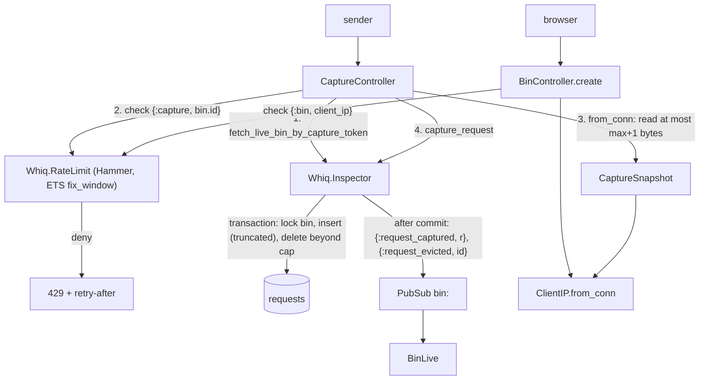

# Abuse Limits Design

**Spec**: `.specs/features/abuse-limits/spec.md`
**Status**: Approved

---

## Architecture Overview

Rate limits are a web-layer concern checked before any body is read or any row is written. Body truncation and the ring buffer are domain rules owned by `Whiq.Inspector`, applied inside one transaction that locks the bin row. Broadcasts leave only after that transaction commits.



### Approaches considered

| Approach | Verdict |
| -------- | ------- |
| **A. Hammer checks in the controllers, truncation + ring buffer in `Inspector` under a bin row lock** (chosen) | Rate limit runs before the body is read (LIM-12 for free); domain rules stay in the context, so every caller of `capture_request/2` gets them. |
| B. Plug in the `/h` scope keyed by token | Unknown tokens would occupy ETS entries; the `/h` scope has no pipeline by design (AD-001). Rejected. |
| C. Postgres trigger for the ring buffer | Hides the rule in the database and makes broadcasting the evicted id awkward. Rejected. |

---

## Code Reuse Analysis

### Existing Components to Leverage

| Component | Location | How to Use |
| --------- | -------- | ---------- |
| `Inspector.capture_request/2` | `lib/whiq/inspector.ex:56` | Gains the transaction, truncation and eviction; keeps its signature |
| `Inspector.list_requests/1` | `lib/whiq/inspector.ex:89` | `BinLive` reuses it to pick the newest remaining request after an eviction (LIVE-14) |
| `CaptureSnapshot.read_full_body/2` | `lib/whiq_web/capture_snapshot.ex:30` | Becomes a bounded read |
| `CaptureSnapshot.remote_ip/1` | `lib/whiq_web/capture_snapshot.ex:47` | Moves to `WhiqWeb.ClientIP` so bin creation keys on the real client IP |
| `BinLive.newest/2`, `select/2` | `lib/whiq_web/live/bin_live.ex:34,68` | Reselection after eviction |
| Real-server test harness | `test/whiq_web/capture_server_test.exs` | Truncation over real HTTP (unread remainder) |
| `Layouts.app` flash | `lib/whiq_web/controllers/page_html/home.html.heex:1` | Shows the LIM-09 message on the home page |

### Integration Points

| System | Integration Method |
| ------ | ------------------ |
| Database | New column `requests.body_truncated boolean not null default false`; one `SELECT ... FOR UPDATE` on `bins` per capture; eviction `DELETE ... RETURNING id` using the `[:bin_id, :inserted_at]` index |
| Supervision tree | `Whiq.RateLimit` started in `Whiq.Application` before the endpoint |
| Hex | `{:hammer, "~> 7.5"}`, locked at 7.5.0 (2026-09-02); 7.5.1 is one day old |

---

## Components

### `Whiq.RateLimit`

- **Purpose**: Fixed-window counters in ETS.
- **Location**: `lib/whiq/rate_limit.ex`
- **Interfaces**:
  - `use Hammer, backend: :ets` (default algorithm `:fix_window`): provides `start_link/1`, `child_spec/1`, `hit/3`.
  - `check(key :: term(), limit :: pos_integer(), scale_ms :: pos_integer()) :: :ok | {:error, retry_after_seconds :: pos_integer()}`: wraps `hit/3`; `{:deny, ms}` becomes `{:error, max(1, ceil(ms / 1000))}`.
- **Dependencies**: Hammer 7.5
- **Reuses**: none

Limits are read by the callers from app config:

```elixir
config :whiq, :capture_rate_limit, limit: 60, scale_ms: :timer.minutes(1)
config :whiq, :bin_rate_limit, limit: 10, scale_ms: :timer.hours(1)
config :whiq, :max_body_bytes, 524_288
config :whiq, :max_requests_per_bin, 100
```

`config/test.exs` sets `capture_rate_limit: [limit: 2, scale_ms: :timer.hours(1)]` and `bin_rate_limit: [limit: 1, scale_ms: :timer.hours(1)]`. Body and request caps keep their real values so the tests assert the spec numbers.

### `WhiqWeb.ClientIP`

- **Purpose**: The client IP as a string, from the configured proxy header (`fly-client-ip` in prod) or the peer address.
- **Location**: `lib/whiq_web/client_ip.ex`
- **Interfaces**: `from_conn(Plug.Conn.t()) :: String.t()`: moved verbatim from `CaptureSnapshot.remote_ip/1`.
- **Reuses**: existing logic and its tests (CAP-14, CAP-20 stay green).

### `WhiqWeb.CaptureSnapshot` (changed)

- `from_conn/1` reads at most `max_body_bytes + 1` bytes and then stops (no drain). The snapshot's `body` may therefore be one byte longer than the cap; the `Inspector` decides truncation.
- `remote_ip` comes from `ClientIP.from_conn/1`.

### `Whiq.Inspector` (changed)

- `capture_request(bin, snapshot) :: {:ok, CapturedRequest.t()} | {:error, :not_found}`:
  1. `Repo.transaction`: `SELECT id FROM bins WHERE id = $1 FOR UPDATE`; no row → rollback `:not_found` (bin pruned between lookup and capture).
  2. Insert with `body = binary_part(body, 0, min(size, max))`, `body_truncated = size > max`, `body_size = byte_size(stored body)` (LIM-01, LIM-02, LIM-11).
  3. `DELETE FROM requests WHERE id IN (SELECT id FROM requests WHERE bin_id = $1 ORDER BY inserted_at DESC, id DESC OFFSET max_requests) RETURNING id` (LIM-03, LIM-04).
  4. After commit: broadcast `{:request_captured, request}`, then `{:request_evicted, id}` per evicted id (LIM-05).
- `inserted_at` is autogenerated by `Repo.insert` after the lock is held, so eviction order matches arrival order and `list_requests/1` order.

### `WhiqWeb.CaptureController` (changed)

After the bin lookup and before `CaptureSnapshot.from_conn/1`: `RateLimit.check({:capture, bin.id}, limit, scale_ms)`. `{:error, s}` → `put_resp_header("retry-after", to_string(s))`, 429, empty body, nothing read or stored (LIM-06, LIM-08, LIM-12). `{:error, :not_found}` from `capture_request/2` → 404.

### `WhiqWeb.BinController` (changed)

`RateLimit.check({:bin, ClientIP.from_conn(conn)}, ...)` before `create_bin/0`. Deny → `put_flash(:error, "Too many bins created. Try again later.")` and redirect to `/` (LIM-09, LIM-10).

### `WhiqWeb.BinLive` (changed)

- `handle_info({:request_evicted, id}, socket)`: `stream_delete_by_dom_id(:requests, "requests-#{id}")`, decrement `request_count` (LIVE-04). When `selected.id == id`, select the newest remaining via `newest/2` and re-insert its row (LIVE-14).
- Detail pane: `#body-truncated` notice "Body truncated: showing the first <body_size> bytes" when `body_truncated` (LIVE-10).

---

## Data Models

```elixir
# migration add_body_truncated_to_requests
alter table(:requests) do
  add :body_truncated, :boolean, null: false, default: false
end

# CapturedRequest
field :body_truncated, :boolean, default: false
```

PubSub adds `{:request_evicted, request_id :: integer()}` on topic `bin:<id>`.

---

## Error Handling Strategy

| Error Scenario | Handling | User Impact |
| -------------- | -------- | ----------- |
| Capture over the per-bin rate | 429, `retry-after` in whole seconds (min 1), nothing read or stored | Sender sees when to retry |
| Bin creation over the per-IP rate | Flash error, redirect to `/`, no bin | "Too many bins created. Try again later." |
| Body over 512 KB | Stored truncated, 200 | Bin page shows the truncation notice |
| Bin deleted between lookup and lock | Transaction rolls back `:not_found`, 404 | Same as an expired bin |
| Selected request evicted | Newest remaining becomes the selection | Detail pane never shows a deleted row |

---

## Risks & Concerns

| Concern | Location (file:line) | Impact | Mitigation |
| ------- | -------------------- | ------ | ---------- |
| Bandit's behaviour when the handler responds without reading the whole body is unverified | `lib/whiq_web/capture_snapshot.ex:30` | Sender could see a reset instead of 200, or the connection could stall | Real-server test sends 524,289+ bytes and asserts the status line is 200 and the stored row is truncated |
| Sandbox serializes all processes on one connection, so a concurrency test inside it never contends the lock | `test/support/data_case.ex` | LIM-04 would pass even without `FOR UPDATE` | LIM-04 runs in an `async: false` module with the sandbox in `:auto` mode, real parallel tasks, cleanup by deleting the bin in `on_exit`. Not verified yet that `:auto` gives separate connections; checked in the task |
| `fly-client-ip` logic lived only in the capture path | `lib/whiq_web/capture_snapshot.ex:47` | Bin limit keyed on `conn.remote_ip` would put every Fly client behind the proxy IP into one bucket | Extract `ClientIP`; LIM-10 test uses two distinct IPs |
| Hammer fixed windows align to wall-clock time and take no injected clock | `deps/hammer/lib/hammer/ets/fix_window.ex:99` | LIM-07 cannot advance time; a window boundary can fall between hits | LIM-07 is a unit test on `RateLimit.check/3` with `scale_ms: 1000`: hit until `{:error, s}`, wait the denied interval, assert `:ok`. LIM-06 tests use a one-hour scale, so a boundary mid-test is negligible |
| Hammer counts denied hits too (`update_counter` before the comparison) | same | None within a window; the window resets anyway | Accepted |
| Rate-limit ETS is shared across async tests | `config/test.exs` | Counters could leak between tests | Keys are bin ids (unique per test) and explicit per-test IPs |
| Every capture now takes a row lock on its bin | `lib/whiq/inspector.ex:56` | Captures to one bin serialize | Intended (AD-007); different bins do not contend |
| Retention will delete bins while captures hold the lock | `retention` feature | Cascade waits for the lock; brief | Accepted |

---

## Tech Decisions (only non-obvious ones)

| Decision | Choice | Rationale |
| -------- | ------ | --------- |
| Who truncates | `Inspector`, from a snapshot read up to `max + 1` | One extra byte tells "exactly at cap" (LIM-02) from "over cap" (LIM-01); the domain keeps `body_size` consistent |
| Eviction ordering | `inserted_at desc, id desc`, same as `list_requests/1` | "Oldest" means the same thing on the page and in the eviction |
| Broadcast order | captured, then evicted | When the selection is evicted, the newest remaining is already on the page |
| `retry-after` rounding | `ceil`, minimum 1 | A `0` would invite an immediate retry inside the same window |
| Limits as keyword config, passed to `check/3` | Callers read config | `RateLimit` stays testable with explicit values without mutating global config |
