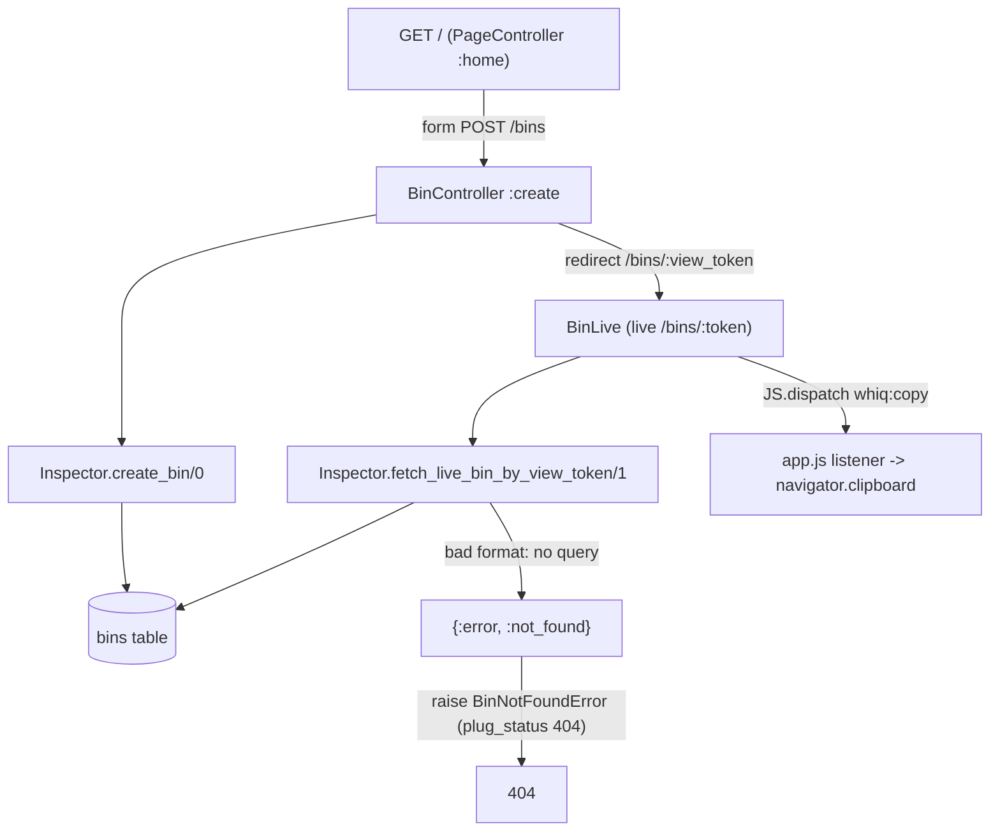

# Bin Creation Design

**Spec**: `.specs/features/bin-creation/spec.md`
**Status**: Approved

---

## Architecture Overview

The home page stays a dead view with a CSRF-protected form. `POST /bins` creates the bin through the `Inspector` context and redirects to the bin page. The bin page is a LiveView, because `live-inspection` streams captured requests into it later. Tokens are generated and their format is checked inside the context. The web layer only translates "not found" into a 404.



---

## Code Reuse Analysis

### Existing Components to Leverage

| Component | Location | How to Use |
| --------- | -------- | ---------- |
| `:browser` pipeline (parsers, CSRF, session) | `lib/whiq_web/router.ex:4` | `POST /bins` and `live /bins/:token` go in the existing `/` scope |
| `PageController.home` + `home.html.heex` | `lib/whiq_web/controllers/page_controller.ex`, `page_html/home.html.heex` | Replace the Phoenix boilerplate with the product home and a "Create bin" form |
| `Layouts.app` / `flash_group` | `lib/whiq_web/components/layouts.ex:36` | Wraps both pages; the flash slot is where LIM-09 will show its message later |
| `<.button>`, `<.icon>` | `lib/whiq_web/components/core_components.ex` | Create and Copy buttons |
| `DataCase`, `ConnCase` | `test/support/` | Context tests and Conn/LiveView tests |
| `phoenix_ecto` 404 mapping | dependency | Not used directly: BIN-12 needs a 404 without a query, so it uses its own exception (see Tech Decisions) |
| `app.js` global listeners | `assets/js/app.js:37` | Add a `whiq:copy` listener next to the topbar listeners |

### Integration Points

| System | Integration Method |
| ------ | ------------------ |
| Database | New `bins` table, first migration in the project |
| `request-capture` (next feature) | Looks bins up by `capture_token` through the same context; this design adds no capture lookup yet |
| `live-inspection` | Extends `BinLive` (mount already loads the bin) |
| `retention` | Deletes by `expires_at`; its index belongs to that feature |
| `abuse-limits` LIM-09 | Plug or guard in front of `BinController.create`, plus a flash on `/` |

---

## Components

### `Whiq.Inspector.Bin` (schema)

- **Purpose**: Persisted bin with its two tokens and expiry.
- **Location**: `lib/whiq/inspector/bin.ex`
- **Interfaces**: Ecto schema only. No user-facing changeset, because every field is set programmatically (AGENTS.md: programmatic fields are not cast).
- **Dependencies**: `Ecto.Schema`
- **Reuses**: n/a

### `Whiq.Inspector` (context)

- **Purpose**: The only module that creates and looks up bins.
- **Location**: `lib/whiq/inspector.ex`
- **Interfaces**:
  - `create_bin() :: {:ok, Bin.t()}`: generates both tokens, sets `inserted_at = now` (truncated to the second) and `expires_at = inserted_at + 7 days`, then inserts the bin. A unique-index collision raises (spec: no retry).
  - `fetch_live_bin_by_view_token(token :: String.t()) :: {:ok, Bin.t()} | {:error, :not_found}`: returns `:not_found` without querying when the token does not match `~r/\A[A-Za-z0-9_-]{32}\z/` (BIN-12). Otherwise it queries `view_token == ^token and expires_at > ^now` (BIN-08, BIN-09, BIN-10).
- **Dependencies**: `Whiq.Repo`, `:crypto`
- **Reuses**: n/a
- Token generation is a private function: `:crypto.strong_rand_bytes(24) |> Base.url_encode64(padding: false)`, which yields 32 characters.

### `WhiqWeb.BinController`

- **Purpose**: `create/2` calls `Inspector.create_bin/0` and redirects to `~p"/bins/#{bin.view_token}"`.
- **Location**: `lib/whiq_web/controllers/bin_controller.ex`
- **Dependencies**: `Whiq.Inspector`
- **Reuses**: `:browser` pipeline (CSRF)

### `WhiqWeb.BinLive`

- **Purpose**: Private bin page. It shows the capture URL with a Copy button, the expiry in ISO 8601 UTC, and the "save this URL" notice.
- **Location**: `lib/whiq_web/live/bin_live.ex`
- **Interfaces**: `mount(%{"token" => token}, _, socket)`. On `{:error, :not_found}` it raises `WhiqWeb.BinNotFoundError`.
- **Renders**:
  - `#capture-url` (input readonly, value `url(~p"/h/#{bin.capture_token}")`)
  - `#copy-capture-url` button, `phx-click={JS.dispatch("whiq:copy", to: "#capture-url")}`
  - `#expires-at` showing `DateTime.to_iso8601(bin.expires_at)`
  - `#save-url-notice`
- **Constraint**: never assigns or renders `view_token` (BIN-11). Only `capture_token`, `expires_at` and derived values go into the assigns.
- **Reuses**: `Layouts.app`, `core_components`

### `WhiqWeb.BinNotFoundError`

- **Purpose**: An exception with `plug_status: 404` that turns into the standard 404 page through `ErrorHTML`.
- **Location**: `lib/whiq_web/bin_not_found_error.ex` (its own file, per AGENTS.md)

### Clipboard listener

- **Purpose**: Handles `whiq:copy` and calls `navigator.clipboard.writeText(e.target.value)` (BIN-07).
- **Location**: `assets/js/app.js`, next to the existing `window.addEventListener` calls
- **Reuses**: the `JS.dispatch` pattern documented by LiveView. No hook, since there is no DOM state to manage.

---

## Data Models

### `bins`

```elixir
create table(:bins) do            # bigserial id (Phoenix default)
  add :capture_token, :string, null: false
  add :view_token, :string, null: false
  add :expires_at, :utc_datetime, null: false
  timestamps(type: :utc_datetime, updated_at: false)
end

create unique_index(:bins, [:capture_token])
create unique_index(:bins, [:view_token])
```

**Relationships**: `request-capture` will add `requests.bin_id` with `on_delete: :delete_all` (AD-006 cascade).

---

## Error Handling Strategy

| Error Scenario | Handling | User Impact |
| -------------- | -------- | ----------- |
| Unknown, capture-token, expired or badly formatted token at `/bins/:token` | Context returns `{:error, :not_found}`; `BinLive` raises `BinNotFoundError` (404) | Standard 404 page, with no hint about whether the token ever existed |
| Token collision on insert | `Ecto.ConstraintError` propagates and the request returns 500 | Practically unreachable (192 bits), accepted by the spec |
| Bin expires while its page is open | Out of scope here; `live-inspection`/`retention` handle it | Page stays until reload, then 404 |
| Clipboard API unavailable (insecure context, denied) | The listener swallows the rejection; the input stays selectable | Visitor copies manually |

---

## Risks & Concerns

| Concern | Location (file:line) | Impact | Mitigation |
| ------- | -------------------- | ------ | ---------- |
| BIN-07 cannot be asserted end to end without a browser (no e2e harness) | `assets/js/app.js` | A broken listener would pass the LiveView tests | The test asserts the button's `phx-click` dispatches `whiq:copy` to `#capture-url`, and that the input value is the capture URL. The clipboard write itself goes into the manual UAT checklist |
| BIN-11 is a statement about the rendered HTML, so it needs a raw-HTML `refute` | `test/whiq_web/live/bin_live_test.exs` | Goes against the AGENTS.md "never test raw HTML" guideline | This is a deliberate exception: the requirement is the absence of a string in the response, so both the dead render and the connected render are checked |
| `navigator.clipboard` requires a secure context; dev over `http://localhost` qualifies, a LAN IP does not | `assets/js/app.js` | Copy silently fails on `http://<lan-ip>` | Graceful failure (see Error Handling); production is HTTPS |
| Generator boilerplate (Phoenix branding, external links) in the layout header | `lib/whiq_web/components/layouts.ex:38-60` | Product pages show "Phoenix v1.8" and links to GitHub/Phoenix | The home task replaces the header with the whiq brand. Same file, small diff |
| Verified routes against a `match :*` route (`/h/:token`) | `lib/whiq_web/router.ex:22` | If not verifiable, `~p"/h/..."` emits a compile warning, and `--warnings-as-errors` fails the build | Not verified yet. The first BinLive task compiles under `mix precommit`; if it warns, fall back to `url(~p"/") <> "h/" <> token`, still built from the endpoint URL (BIN-04) |

---

## Tech Decisions

| Decision | Choice | Rationale |
| -------- | ------ | --------- |
| Creation transport | `POST /bins` controller, not a LiveView event | User choice: correct HTTP semantics, works without JS, and LIM-09 becomes a plug plus a flash on the same route |
| Where the token format check (BIN-12) lives | Context (`fetch_live_bin_by_view_token/1`) | The guarantee "no query for a malformed token" belongs next to the query; the web layer stays thin |
| 404 mechanism | Its own `BinNotFoundError` (plug_status 404) | `Ecto.NoResultsError` needs a queryable and implies that a query ran; a single exception covers all four not-found cases uniformly |
| Timestamp precision | `:utc_datetime` (seconds), `inserted_at` set by the context | BIN-03 requires exactly 7 days; setting both values from the same `now` removes drift between autogenerate and the computed field |
| Proving "no DB query" (BIN-12) | Test attaches a `:telemetry` handler to `[:whiq, :repo, :query]` and asserts zero events | Deterministic, with no mocks |
| Copy mechanism | `JS.dispatch` plus a global listener in `app.js` | The pattern documented by LiveView; a hook would be needless state |

No new project-level decision: everything stays within AD-003, AD-005 and AD-006.
