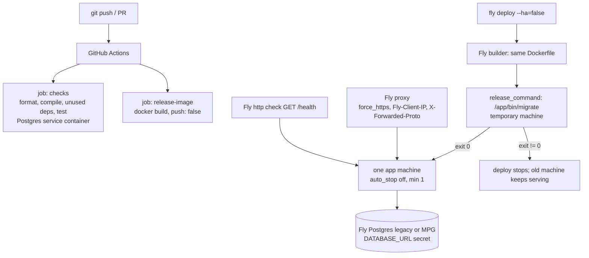

# Delivery Design

**Spec**: `.specs/features/delivery/spec.md`
**Status**: Approved

---

## Architecture Overview

Three independent deliverables share one artefact, the release image built from the generated `Dockerfile`. CI builds it on every push and pull request (DEL-11) but never pushes it. A manual `fly deploy` builds it again and ships it.

---

## Code Reuse Analysis

### Existing Components to Leverage

| Component | Location | How to Use |
| --------- | -------- | ---------- |
| Release generator | `deps/phoenix/priv/templates/phx.gen.release/` | `mix phx.gen.release --docker` writes `Dockerfile`, `.dockerignore`, `rel/overlays/bin/{server,migrate}`, `lib/whiq/release.ex` unchanged |
| `Whiq.Release.migrate/0` (generated) | `lib/whiq/release.ex` | `release_command`; `Ecto.Migrator.with_repo` starts only the Repo, so Oban and the endpoint do not boot in the temporary machine. It applies `oban_jobs` like any other migration |
| Prod runtime config | `config/runtime.exs` | Already reads `DATABASE_URL`, `SECRET_KEY_BASE`, `PHX_HOST`, `PORT`, `ECTO_IPV6`, and sets `:client_ip_header` to `fly-client-ip` (DEL-06) |
| `force_ssl` | `config/prod.exs:13` | Add `paths: ["/health"]` to the existing `exclude` list (Plug.SSL supports it, `deps/plug/lib/plug/ssl.ex:66`) |
| `WhiqWeb.ClientIP` | `lib/whiq_web/client_ip.ex` | Unchanged; DEL-06/07 verified live |
| Capture scope pattern | `lib/whiq_web/router.ex:23` | `/health` gets its own scope without a pipeline, same as `/h` |
| `mix precommit` | `mix.exs:100` | CI runs its non-mutating equivalents |
| compose `db` service | `compose.yaml` | README local setup reuses `docker compose` as-is |

### Integration Points

| System | Integration Method |
| ------ | ------------------ |
| Fly proxy | `fly.toml` `[http_service]`: `force_https = true` (DEL-04), `internal_port` matches `PORT` |
| Fly Postgres | `fly postgres attach` (legacy) or `fly mpg attach` sets the database URL secret; if MPG names it differently, set `DATABASE_URL` explicitly |
| GitHub | `.github/workflows/ci.yml`; the README badge points at it |

---

## Components

### Release artefacts (generated)

- **Purpose**: Build a self-contained OTP release image and expose `server` / `migrate` entry points.
- **Location**: `Dockerfile`, `.dockerignore`, `rel/overlays/bin/`, `lib/whiq/release.ex`
- **Interfaces**: `/app/bin/server` (CMD), `/app/bin/migrate` (release_command)
- **Dependencies**: `hexpm/elixir:<elixir>-erlang-<otp>-debian-<debian>` builder tag must exist. The generator picks versions from the running toolchain (Elixir 1.19.6 / OTP 28 in `Dockerfile.dev`)
- **Reuses**: generator output, with no edits unless the image build fails

### Health endpoint

- **Purpose**: Answer Fly's internal HTTP check with 200 without touching the DB or being redirected (DEL-13).
- **Location**: `lib/whiq_web/controllers/health_controller.ex`, route `get "/health"` in a pipeline-less scope
- **Interfaces**: `GET /health` → `200 text/plain "ok"`
- **Dependencies**: none (liveness only; a DB outage must not pull the only machine out of routing)
- **Reuses**: the `/h` scope pattern; `force_ssl` `exclude: [paths: ["/health"]]`

### `fly.toml`

- **Purpose**: Declarative Fly config for one always-on machine.
- **Location**: `fly.toml`
- **Contents**:
  - `primary_region = "gru"`
  - `[deploy] release_command = "/app/bin/migrate"`
  - `[env]`: `PHX_HOST`, `PORT = "8080"`, `ECTO_IPV6 = "true"`, `ERL_AFLAGS = "-proto_dist inet6_tcp"`
  - `[http_service]`: `internal_port = 8080`, `force_https = true`, `auto_stop_machines = "off"`, `auto_start_machines = true`, `min_machines_running = 1`
  - `[[http_service.checks]]`: `GET /health`, `grace_period`, `interval`, `timeout`
  - `[[vm]]`: shared-cpu-1x
- **Dependencies**: app created with `fly launch --no-deploy` (or `fly apps create`). The first deploy uses `--ha=false` (DEL-12)

### CI workflow

- **Purpose**: Run checks and build the release image on every push to `main` and every pull request (DEL-01, DEL-02, DEL-11).
- **Location**: `.github/workflows/ci.yml`
- **Jobs**:
  - `checks`: `erlef/setup-beam@v1` (`version-type: strict`, versions pinned to `Dockerfile.dev`), `actions/cache` on `deps` + `_build` keyed by `mix.lock` hash and versions, `postgres:17` service with `pg_isready` health options, `MIX_ENV=test`. Steps: `mix deps.get`, `mix format --check-formatted`, `mix compile --warnings-as-errors`, `mix deps.unlock --check-unused`, `mix test`
  - `release-image`: `docker/setup-buildx-action@v4` + `docker/build-push-action@v7`, `push: false`, `cache-from/to: type=gha`
- **Dependencies**: test config already defaults to `localhost` / `postgres:postgres` (`config/test.exs:9-11`)

### README

- **Purpose**: Reviewer entry point (DEL-08, DEL-09).
- **Location**: `README.md`
- **Sections**: tagline + CI badge + live demo link · what it does · local setup (`cp .env.example .env`, `docker compose up`) · architecture overview (contexts, capture path, LiveView/PubSub, Oban retention, single-node rationale) · Decisions (one short entry per active `AD-NNN`, plus the deploy assumptions: single machine, failed `release_command` keeps the old release) · known fidelity limits (lowercased header names, plain-HTTP captures redirected and not stored)

---

## Error Handling Strategy

| Error Scenario | Handling | User Impact |
| -------------- | -------- | ----------- |
| Migration fails in `release_command` | Fly stops the deploy (verified in docs); old machine keeps serving (inferred; documented assumption) | None; operator sees a failed deploy |
| Missing `DATABASE_URL` / `SECRET_KEY_BASE` | `config/runtime.exs` raises at boot | Deploy fails; old release keeps serving |
| Plain-HTTP request | Fly proxy `force_https` 301, never reaches the app | Sender must use HTTPS; documented in README |
| Health check over plain HTTP | `/health` excluded from `force_ssl` | Machine stays in rotation |
| CI check or image build fails | Job fails → run marked failed | Red check on PR |

---

## Risks & Concerns

| Concern | Location (file:line) | Impact | Mitigation |
| ------- | -------------------- | ------ | ---------- |
| Fly docs do not guarantee that the proxy overwrites a client-sent `Fly-Client-IP` | `lib/whiq_web/client_ip.ex:10` | Forged IP would bypass the per-IP rate limit | DEL-07 live curl test; plan B already in spec (right-parsed `x-forwarded-for`) as a fix task |
| `fly deploy` creates 2 machines by default | `fly.toml` | Breaks per-node limiter, PubSub and cron assumptions | First deploy with `--ha=false`; DEL-12 checked with `fly machine list` |
| `force_ssl rewrite_on: [:x_forwarded_proto]` trusts that header | `config/prod.exs:15` | A direct hit bypassing the proxy could claim https | Fly only exposes the app through its proxy, which sets the header; no public machine IP is allocated besides the proxy |
| Generated builder tag may not exist for the exact Elixir/OTP/Debian triple | `Dockerfile` | Image build fails | The CI `release-image` job catches it; pin to an existing hexpm tag |
| `force_ssl` and the `/health` exclusion are compile-time prod config, not exercised by `mix test` | `config/prod.exs` | Exclusion regressions go unnoticed in CI | DEL-13 verified live through Fly's check status; the route itself is covered by an ExUnit test |
| Legacy Fly Postgres may no longer create new clusters | deploy runbook | Deploy blocked on DB | Fallback to `fly mpg create` (spec assumption) |
| CI and deploy verification need a push and a Fly account | outward-facing | Tasks cannot self-verify DEL-01..07, 11..13 | Those ACs are verified manually after explicit go-ahead to push / deploy; recorded in `validation.md` |

---

## Tech Decisions (only non-obvious ones)

| Decision | Choice | Rationale |
| -------- | ------ | --------- |
| IPv6 env vars | `ECTO_IPV6` / `ERL_AFLAGS` in `fly.toml [env]`, not in the Dockerfile | Keeps the image runnable outside Fly (for example a local `docker run` against IPv4 Postgres); Fly's guide puts them in the Dockerfile |
| Health check depth | Liveness only, no DB query | With one machine, a failing check only removes the sole backend from routing; it does not fix the DB |
| Health route vs header | Dedicated `/health` excluded from `force_ssl` | Explicit and greppable; it also works if checks change protocol. Alternative: send `X-Forwarded-Proto: https` from the check to `/` |
| Region | `gru` (São Paulo) | Nearest to the author |
| Port | `PORT=8080` | Fly convention; `config/runtime.exs` already reads `PORT` |
