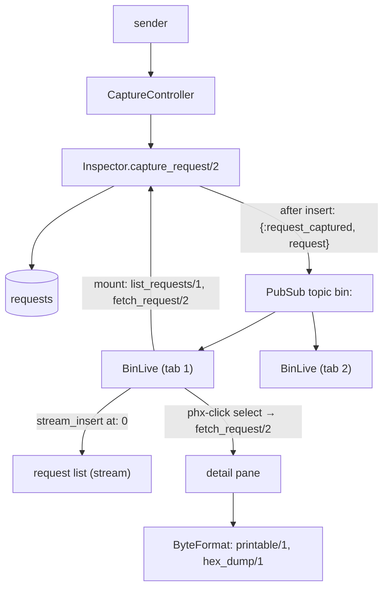

# Live Inspection Design

**Spec**: `.specs/features/live-inspection/spec.md`
**Status**: Approved

---

## Architecture Overview

`Inspector.capture_request/2` broadcasts every stored request on a per-bin `Phoenix.PubSub` topic. `BinLive` subscribes to its bin's topic once the socket is connected, keeps the list in a LiveView stream (newest first) and holds the selected request in a regular assign. Every byte that came from a sender passes through `WhiqWeb.ByteFormat` before it reaches the template, so the diff is always valid UTF-8, and HEEx escapes it.

### Approaches considered

| Approach | Verdict |
| -------- | ------- |
| **A. Broadcast from `Inspector.capture_request/2`, LiveView streams** (chosen) | The context owns the event, so every capture path broadcasts. The spec fixes PubSub + streams. |
| B. Broadcast from `CaptureController` | Any other caller of `capture_request/2` (tests, `abuse-limits`' transaction) would skip the broadcast. Rejected. |
| C. Postgres `LISTEN/NOTIFY` | Works across nodes without PubSub clustering, but the app runs on one node and PubSub is already started. Rejected as overkill. |

---

## Code Reuse Analysis

### Existing Components to Leverage

| Component | Location | How to Use |
| --------- | -------- | ---------- |
| `Phoenix.PubSub` named `Whiq.PubSub` | `lib/whiq/application.ex:14` | Topic per bin; no new process |
| `Inspector.capture_request/2` | `lib/whiq/inspector.ex:56` | Broadcasts after a successful insert |
| `BinLive.mount/3` | `lib/whiq_web/live/bin_live.ex:8` | Gains subscription, stream and selection; still assigns derived values only (BIN-11) |
| `CapturedRequest` schema | `lib/whiq/inspector/captured_request.ex` | Read as is; pairs rebuilt with `Enum.chunk_every(headers, 2)` (AD-008) |
| `BinLiveTest` setup + `LazyHTML` queries | `test/whiq_web/live/bin_live_test.exs` | Same style for the new ACs |
| `String.chunk/2` with `:valid` | Elixir stdlib | Splits a binary into valid and invalid UTF-8 runs for `printable/1` |

### Integration Points

| System | Integration Method |
| ------ | ------------------ |
| Database | Two reads on `requests`: the list (summary columns, `[:bin_id, :inserted_at]` index) and one row by id scoped to the bin |
| `abuse-limits` | Will add `{:request_evicted, id}` on the same topic (LIM-05) and handle it in `BinLive` (LIVE-04, LIVE-14). The broadcast in `capture_request/2` must stay after the transaction commits |

---

## Components

### `Whiq.Inspector` (context, extended)

- **Purpose**: Request reads and the capture broadcast.
- **Location**: `lib/whiq/inspector.ex`
- **Interfaces**:
  - `subscribe(bin :: Bin.t()) :: :ok`: subscribes the caller to `"bin:#{bin.id}"`. The topic string lives only in this module.
  - `capture_request/2` (changed): after `{:ok, request}` it broadcasts `{:request_captured, request}` on the bin's topic and returns `{:ok, request}` (LIVE-02, LIVE-03).
  - `list_requests(bin :: Bin.t()) :: [CapturedRequest.t()]`: the bin's requests ordered `inserted_at desc, id desc`, loading only `id, method, path, body_size, inserted_at` (LIVE-01).
  - `fetch_request(bin :: Bin.t(), id :: integer()) :: {:ok, CapturedRequest.t()} | {:error, :not_found}`: full row, only when it belongs to `bin`.
- **Dependencies**: `Whiq.Repo`, `Phoenix.PubSub`
- **Reuses**: the existing context

### `WhiqWeb.ByteFormat`

- **Purpose**: Turns sender-controlled bytes into display-safe UTF-8 strings.
- **Location**: `lib/whiq_web/byte_format.ex`
- **Interfaces**:
  - `body(body :: binary()) :: :empty | {:text, String.t()} | {:hex, String.t()}`: `""` → `:empty` (LIVE-09); valid UTF-8 → `:text` (LIVE-07); anything else → `:hex` of the whole body (LIVE-08, LIVE-15).
  - `hex_dump(binary()) :: String.t()`: one line per 16 bytes, `"<8-digit hex offset>  <bytes as lowercase hex pairs, space-separated>"`, lines joined by `"\n"`. Example: `"00000000  ff 00 41"`.
  - `printable(binary() | nil) :: String.t()`: valid UTF-8 unchanged; each byte of an invalid run replaced by `\xNN` (lowercase). `nil` → `""`. Used for header names, header values and `content_type` (AD-008).
- **Dependencies**: none
- **Reuses**: `String.valid?/1`, `String.chunk/2`, `Base.encode16/2`

### `WhiqWeb.BinLive` (extended)

- **Purpose**: The bin page: capture URL (existing), live request list, detail pane.
- **Location**: `lib/whiq_web/live/bin_live.ex`
- **Interfaces**:
  - `mount/3`: after the bin lookup, `Inspector.subscribe(bin)` when `connected?/1`; `stream(:requests, list)`; `request_count`; `selected` = full newest request or `nil` (LIVE-12). The `bin` struct is kept in assigns for later reads, but the template never renders `view_token` (BIN-11 test stays).
  - `handle_info({:request_captured, request}, socket)`: `stream_insert(:requests, request, at: 0)`, increments `request_count`; selects the request only when `selected` is `nil` (LIVE-13).
  - `handle_event("select", %{"id" => id}, socket)`: parses `id` with `Integer.parse/1`, calls `fetch_request/2`, re-inserts the previous and new rows so the highlight moves; an unparsable or foreign id leaves the page unchanged.
  - Template: `#requests` (`phx-update="stream"`), rows `#requests-<id>` with method, path, ISO 8601 timestamp, body size (LIVE-01); `#empty-state` with `curl -d 'hello' <capture_url>` when `request_count == 0` (LIVE-05); `#request-detail` with every field and a `#request-headers` list in stored order (LIVE-06), body as `<pre>` text, hex dump or "(empty body)" (LIVE-07..09).
- **Dependencies**: `Whiq.Inspector`, `WhiqWeb.ByteFormat`
- **Reuses**: existing layout, copy button, `<.icon>`

---

## Data Models

No schema change. The PubSub message is `{:request_captured, %CapturedRequest{}}` with every field loaded.

---

## Error Handling Strategy

| Error Scenario | Handling | User Impact |
| -------------- | -------- | ----------- |
| Non-UTF-8 bytes in a header or `content_type` | `ByteFormat.printable/1` escapes them as `\xNN` | Readable value; the LiveView never crashes on JSON encoding |
| Non-UTF-8 body | Hex dump of the whole body | Readable binary |
| `select` with an id that is not an integer or belongs to another bin | Ignored, page unchanged | None |
| Bin expires while the page is open | Nothing happens until the next navigation, which 404s | Out of scope per spec |
| Request inserted between subscribe and the list query | Subscription starts before the query; the row arrives twice and `stream_insert` replaces by DOM id | None; `request_count` may over-count by one (see Risks) |

---

## Risks & Concerns

| Concern | Location (file:line) | Impact | Mitigation |
| ------- | -------------------- | ------ | ---------- |
| Jason raises on invalid UTF-8 (`deps/jason/lib/jason.ex:157`), and LiveView encodes diffs with Jason | `lib/whiq_web/live/bin_live.ex` | One obs-text header (AD-008) would crash the LiveView for that bin on every load | Every `bytea` field goes through `ByteFormat` before rendering; a LiveView test captures a `0xff` header value and a `0xff` body and asserts the page renders |
| A sender can type the literal text `\xff` | `ByteFormat.printable/1` | Escaped byte and literal text look the same | Accepted: debugging aid, not a byte-exact view. The body has its own hex view |
| Full request (body included) copied into every subscribed LiveView's mailbox | `Inspector.capture_request/2` | Memory per open tab grows with body size, up to the 512 KB cap from `abuse-limits` | Accepted: one node, few viewers per bin; sending only the id would cost one query per viewer per capture |
| Subscribe-then-list race counts a request twice | `BinLive.mount/3` | `request_count` off by one; empty state logic still correct (count > 0) | Count only drives the empty state, so an over-count is harmless; no dedup set is kept |
| `abuse-limits` will wrap insert + eviction in a transaction | `lib/whiq/inspector.ex:56` | Broadcasting inside the transaction could announce a row that rolls back | Noted for `abuse-limits`: broadcast after the transaction returns `{:ok, _}` |
| No current test proves the broadcast reaches only one bin | tests | LIVE-03 regression would go unnoticed | LiveView test with two bins: capture into the other bin, assert the page is unchanged |

---

## Tech Decisions (only non-obvious ones)

| Decision | Choice | Rationale |
| -------- | ------ | --------- |
| Topic key | `bin.id` | Internal and stable; tokens never travel through PubSub |
| List query | Summary columns only | 100 rows × 512 KB bodies would load ~50 MB on mount for a list that shows four fields |
| Empty state | `request_count` assign | Streams cannot be counted; an assign makes LIVE-05 testable with `has_element?/2` |
| First arrival on an empty bin | Selected automatically | LIVE-13 only protects an existing selection; showing the first request avoids an empty detail pane |
| Invalid UTF-8 in headers | `\xNN` per byte | Keeps every byte visible; U+FFFD would hide which bytes were sent |
| Hex dump layout | Offset + hex only, no ASCII gutter | Spec defines offset column and 16 lowercase bytes per line; nothing more |
