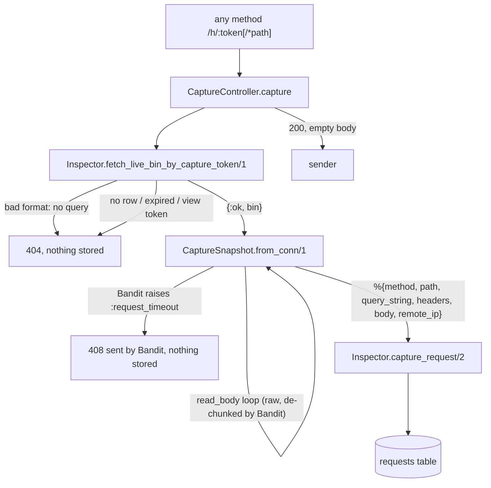

# Request Capture Design

**Spec**: `.specs/features/request-capture/spec.md`
**Status**: Approved

---

## Architecture Overview

The existing `/h` routes keep pointing at `CaptureController`, which has no pipeline (AD-001). The controller looks the bin up by `capture_token` before reading any body bytes. An unknown, expired or view token answers 404 and stores nothing. For a live bin, `WhiqWeb.CaptureSnapshot` drains the raw body with `Plug.Conn.read_body/2` and turns the conn into a plain map (AD-004). `Inspector.capture_request/2` derives `body_size` and `content_type` from that map and inserts the row. The sender gets 200 with an empty body.



### Approaches considered

| Approach | Verdict |
| -------- | ------- |
| **A. Router → controller → web snapshot module → context** (chosen) | Fits AD-001, AD-002 and AD-004 and the routes that already exist. The snapshot module is the only place that knows `Plug.Conn`. |
| B. Dedicated plug in the endpoint that short-circuits `/h` before the router | Saves the router dispatch, but duplicates routing that `router.ex` already does and adds a second place that knows the capture prefix (AD-002 already accepts one). |
| C. Pass `Plug.Conn` to `Inspector` | Violates AD-004. Rejected. |

---

## Code Reuse Analysis

### Existing Components to Leverage

| Component | Location | How to Use |
| --------- | -------- | ---------- |
| `/h` scope, `match :*` routes, no pipeline | `lib/whiq_web/router.ex:22` | Unchanged; the controller action gains the behavior |
| `head_outside_capture/2` | `lib/whiq_web/endpoint.ex:52` | Unchanged; already keeps HEAD as HEAD under `/h` (CAP-02) |
| `fetch_live_bin_by_view_token/1` + `@token_format` | `lib/whiq/inspector.ex:33` | Extracted into a private `fetch_live_bin/2` keyed by field, shared with the new capture-token lookup |
| `Whiq.Inspector.Bin` | `lib/whiq/inspector/bin.ex` | Gains `has_many :requests` for the association |
| `:telemetry` zero-query pattern | `test/whiq/inspector_test.exs:66` | Reused to prove a malformed capture token runs no query |
| `ConnCase`, `DataCase` | `test/support/` | ConnTest for most criteria; DataCase for the context |

### Integration Points

| System | Integration Method |
| ------ | ------------------ |
| Database | New `requests` table, FK `bin_id` → `bins` with `on_delete: :delete_all` (AD-006) |
| `live-inspection` | Reads `requests` by `bin_id` ordered by `inserted_at`; will need a broadcast hook in `capture_request/2` (not added here) |
| `abuse-limits` | Size cap and truncation flag go in `CaptureSnapshot`'s read loop; the 100-row ring buffer goes in `capture_request/2` (AD-007). Neither is added here |
| Fly.io deploy | `config/runtime.exs` sets the client IP header to `fly-client-ip` in prod |

---

## Components

### `Whiq.Inspector.CapturedRequest` (schema)

- **Purpose**: One stored request, byte-exact.
- **Location**: `lib/whiq/inspector/captured_request.ex`
- **Interfaces**: Ecto schema on table `requests`, `belongs_to :bin`. No changeset, because every field is set by the context (same rule as `Bin`).
- **Dependencies**: `Ecto.Schema`
- **Reuses**: `Bin`'s schema conventions

### `Whiq.Inspector` (context, extended)

- **Purpose**: Bin lookup by capture token and request storage.
- **Location**: `lib/whiq/inspector.ex`
- **Interfaces**:
  - `fetch_live_bin_by_capture_token(token :: String.t()) :: {:ok, Bin.t()} | {:error, :not_found}`: returns `:not_found` without a query when the format is wrong. Otherwise it queries `capture_token == ^token and expires_at > ^now` (CAP-16, CAP-17, CAP-18).
  - `capture_request(bin :: Bin.t(), snapshot :: map()) :: {:ok, CapturedRequest.t()}`: `snapshot` is `%{method, path, query_string, headers, body, remote_ip}` with `headers` as Plug-shaped `[{name, value}]`. It sets `body_size = byte_size(body)` (CAP-11), sets `content_type` from the first `content-type` pair or nil (CAP-12), flattens the headers (see Data Models) and inserts the row. It pattern-matches a map, so a `%Plug.Conn{}` never fits (CAP-15).
- **Dependencies**: `Whiq.Repo`
- **Reuses**: the existing lookup, refactored into `fetch_live_bin/2`

### `WhiqWeb.CaptureSnapshot`

- **Purpose**: The only place that turns a `Plug.Conn` into a capture snapshot (AD-004).
- **Location**: `lib/whiq_web/capture_snapshot.ex`
- **Interfaces**:
  - `from_conn(conn :: Plug.Conn.t()) :: {map(), Plug.Conn.t()}`
    - `method`: `conn.method`, as sent (CAP-02)
    - `path`: `conn.request_path` without the `"/h/<token>"` prefix, still percent-encoded; `"/"` when nothing follows (CAP-03, CAP-04)
    - `query_string`: `conn.query_string`, raw (CAP-05)
    - `headers`: `conn.req_headers` in adapter order (CAP-06)
    - `body`: built by looping `read_body/2` through `{:more, ...}` until `{:ok, ...}` and joining the chunks as iodata (CAP-07 to CAP-10, CAP-21). `read_timeout` comes from `:whiq, :capture_read_timeout` and defaults to 15 000 ms (CAP-19)
    - `remote_ip`: when `:whiq, :client_ip_header` is set and its value passes `:inet.parse_strict_address/1`, that value. Otherwise `:inet.ntoa(conn.remote_ip)` (CAP-13, CAP-14, CAP-20)
- **Dependencies**: `Plug.Conn`, `:inet`, application env
- **Reuses**: n/a

### `WhiqWeb.CaptureController` (rewritten)

- **Purpose**: `capture/2` looks up the bin, then builds the snapshot, stores it and answers 200 empty (CAP-01). On `{:error, :not_found}` it answers 404 empty before reading the body (CAP-16 to CAP-18).
- **Location**: `lib/whiq_web/controllers/capture_controller.ex`
- **Dependencies**: `Whiq.Inspector`, `WhiqWeb.CaptureSnapshot`

---

## Data Models

### `requests` table / `CapturedRequest`

```elixir
schema "requests" do
  belongs_to :bin, Whiq.Inspector.Bin       # bigint, null: false, on_delete: :delete_all
  field :method, :string                    # text, null: false
  field :path, :string                      # text, null: false
  field :query_string, :string              # text, null: false ("" when absent)
  field :headers, {:array, :binary}         # bytea[], null: false; [n1, v1, n2, v2, ...]
  field :body, :binary                      # bytea, null: false
  field :body_size, :integer                # integer, null: false
  field :content_type, :binary              # bytea, null: true
  field :remote_ip, :string                 # text, null: false

  timestamps(type: :utc_datetime_usec, updated_at: false)
end
```

- **Index**: `[:bin_id, :inserted_at]`. It covers the FK for the cascade delete and the per-bin listing that `live-inspection` needs.
- **Headers** are stored as a flat `bytea[]` of alternating name/value. A pair array would need a 2-D Postgres array, which Ecto does not map. Flat keeps byte-exact values, including obs-text `0x80–0xFF` that Bandit accepts (`deps/bandit/lib/bandit/headers.ex:20`) and `jsonb`/`text` reject. This supersedes the spec's jsonb assumption; see AD-008.
- **`content_type`** is `bytea` because it is a header value and can hold the same non-UTF-8 bytes.

---

## Error Handling Strategy

| Error Scenario | Handling | User Impact |
| -------------- | -------- | ----------- |
| Token malformed / unknown / expired / view token | `{:error, :not_found}` → `send_resp(404, "")`, body never read | Sender gets 404 |
| Body read stalls past `read_timeout` | Bandit raises `Bandit.HTTPError` (`:request_timeout`) inside `read_body` and sends 408 itself (`deps/bandit/lib/bandit/http1/socket.ex:697`); the insert is never reached | Sender gets 408, nothing stored |
| Client disconnects mid-body | Bandit raises a transport error; nothing stored | None (no one is listening) |
| Bin expires between lookup and insert | The row is inserted anyway; the retention job cascades it later | None; a window of milliseconds |
| Bin deleted between lookup and insert | FK violation raises → 500 | Sender gets 500; the bin is gone, so nothing is lost |

---

## Risks & Concerns

| Concern | Location (file:line) | Impact | Mitigation |
| ------- | -------------------- | ------ | ---------- |
| Unbounded body read into memory | `lib/whiq_web/capture_snapshot.ex` (new) | A large body grows the process heap until a size cap exists | Out of scope (spec: `abuse-limits`); the read loop is the single place where that feature adds the cap and the truncation flag. Not deployed publicly before `abuse-limits` |
| `fly-client-ip` may be client-spoofable | `config/runtime.exs` | Wrong `remote_ip`; rate-limit bypass later | Already accepted in the spec; DEL-07 tests a forged value after deploy |
| CAP-08 and CAP-19 cannot be exercised by `Phoenix.ConnTest` (the test adapter has no chunked framing and no socket timeout) | `test/` | Untested fidelity claims | Real-server test: `start_supervised!({Bandit, plug: WhiqWeb.Endpoint, ip: :loopback, port: 0})`, port from `ThousandIsland.listener_info/1`, raw HTTP/1.1 over `:gen_tcp`, Ecto sandbox in shared mode, `async: false` |
| `Application.put_env` for the client IP header and the read timeout is global | tests | Flaky interference with async tests | Those test modules run `async: false` and restore the env in `on_exit` |

---

## Tech Decisions (only non-obvious ones)

| Decision | Choice | Rationale |
| -------- | ------ | --------- |
| Lookup before body read | 404 without draining the body | Store-nothing paths cost no memory |
| Where `body_size` and `content_type` are derived | `Inspector.capture_request/2` | They are invariants of the stored row, not transport details |
| Recorded path source | `conn.request_path` minus the prefix, not `path_params["path"]` | `path_params` is percent-decoded; `request_path` is what was sent |
| Read timeout config | `:whiq, :capture_read_timeout`, 15 000 ms default, 200 ms in test | CAP-19 is testable without a 15 s test |
| Client IP header config | `:whiq, :client_ip_header`, nil by default, `"fly-client-ip"` in prod via `runtime.exs` | Spec assumption; dev and test use the socket peer |
| Header storage | Flat `bytea[]` | Byte-exact and ordered (AD-008) |
